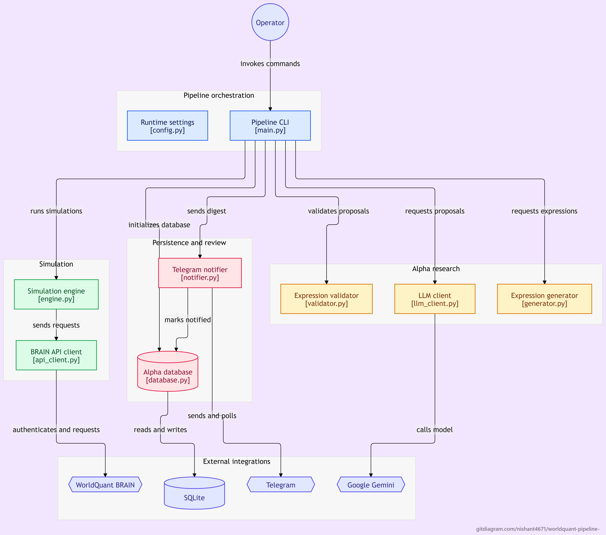

# WorldQuant BRAIN Autonomous Alpha Pipeline

[](https://www.python.org/)
[](https://www.sqlite.org/)
[](https://pytest.org/)
[](https://core.telegram.org/bots)
[](LICENSE)

An enterprise-grade, multi-agent quantitative research and alpha discovery engine for the WorldQuant BRAIN platform. The system orchestrates generative AI hypothesis formulation, deterministic AST static validation, concurrent distributed backtesting, cryptographic deduplication, and human-in-the-loop Telegram approval.

---

## Overview

Developing mathematical trading signals (alphas) at scale requires exploring vast hypothesis spaces while maintaining strict data governance, avoiding platform rate limits, and preventing redundant simulation costs. 

The **WorldQuant BRAIN Autonomous Alpha Pipeline** provides an automated, resilient quantitative workflow:
1. **Hypothesis Generation**: Gemini 2.5 models formulate mathematically sound FASTEXPR alpha candidates across price-volume, fundamental, and analyst datasets.
2. **Deterministic Gatekeeping**: A static expression linter validates operator arity, balance, and strictly verified fields before hitting network endpoints.
3. **Concurrent Backtesting**: A strictly throttled (3-worker) simulation engine coordinates simulations, monitors asynchronous polling states, and extracts in-sample metrics.
4. **Resilience & Fault Tolerance**: Built-in Circuit Breakers, exponential backoff for HTTP 429s, network dropout recovery, and multi-key rotation ensure continuous 24/7 reliability.
5. **Human-in-the-Loop Governance**: Alphas exceeding production thresholds (Sharpe ≥ 1.25, Fitness > 1.0, Turnover within 1–70%) are delivered via Telegram cards for manual review and submission.

---

## System Architecture


*Figure 1: End-to-end architecture detailing the autonomous flow from multi-agent LLM hypothesis generation and static gatekeeping to concurrent simulation, cryptographic deduplication, and Telegram review.*

---

## Key Features

- **Multi-Agent LLM Generation & Critique**: Uses the official Google GenAI SDK (`gemini-2.5-flash`) with a Proposer agent enforcing advanced FASTEXPR operators (`ts_decay_linear`, `group_neutralize`, `ts_zscore`) and an adversarial Portfolio Manager (PM) Critic filtering unviable economic rationales.
- **Dynamic API Key Rotation**: Round-robin failover across multiple Gemini API keys (`GEMINI_API_KEY_1`, `GEMINI_API_KEY_2`, ...) with automatic recovery on HTTP 429 quota exhaustion.
- **Deterministic Hard-Gate Validator**: Rejects hallucinated data fields, validates operator arity (such as `group_rank` parameter requirements), catches Python injection attempts, and allows valid scientific notation constants (e.g., `1e-9`).
- **Cryptographic SHA-256 Deduplication**: Expression normalization and hashing prevent running duplicate backtests, preserving API simulation limits and SQLite storage integrity.
- **Strict Concurrency Control**: Worker thread pooling capped strictly at 3 concurrent simulations to adhere to WorldQuant BRAIN terms of service.
- **Circuit Breaker Kill Switch**: Thread-safe three-state state machine (`CLOSED`, `OPEN`, `HALF_OPEN`) that halts simulation requests upon 3 consecutive 429 responses, alerts Telegram, and enforces a 300-second cooldown.
- **Interactive Telegram Bot**: Formats candidate performance cards (Sharpe, Fitness, Turnover) with inline buttons (`Submit` / `Skip`) backed by a non-blocking background polling daemon.
- **Production Windows Daemon**: VBScript wrapper (`run_listener.vbs`) and PowerShell watchdog (`watchdog_listener.ps1`) for unattended 24/7 background operation.

---

## Documentation

Comprehensive enterprise documentation is maintained in the [`docs/`](docs/) directory:

| Document | Description |
|---|---|
| [System Architecture](docs/ARCHITECTURE.md) | High-level system design, separation of concerns, and Mermaid data flow. |
| [API Reference](docs/API_REFERENCE.md) | WorldQuant REST endpoints and complete Python function signatures. |
| [Quantitative Strategy](docs/QUANT_STRATEGY.md) | Alpha ideation philosophy, Proposer/Critic prompts, field quarantine, and quality gates. |
| [Server Deployment](docs/DEPLOYMENT.md) | Azure Ubuntu production deployment, systemd service, cron scheduling, and log management. |
| [Testing Strategy](docs/TESTING.md) | `pytest-mock` simulation of API errors and LLM hallucinations, test suite inventory. |
| [Contributing & Rules](docs/CONTRIBUTING.md) | Rules of engagement, API key security, concurrency limits, and PR standards. |

---

## Directory Structure

```text
worldquant-pipeline/
├── docs/                  # Enterprise-grade technical and operational documentation
│   ├── ARCHITECTURE.md    # System design, separation of concerns & Mermaid data flow
│   ├── API_REFERENCE.md   # WorldQuant REST API & internal Python interface signatures
│   ├── QUANT_STRATEGY.md  # Alpha generation logic, LLM prompts & quality gates
│   ├── DEPLOYMENT.md      # Azure Ubuntu server, systemd listener & cron automation
│   ├── TESTING.md         # Unit testing strategy, pytest-mock & failure simulation
│   └── CONTRIBUTING.md    # Team rules of engagement, code style & PR checklist
├── api_client.py          # Thread-safe WorldQuant BRAIN REST client (auth, retry, backoff)
├── config.py              # Environment configuration, pydantic settings, dynamic key loader
├── database.py            # SQLite schema, migration, SHA-256 deduplication, query layer
├── engine.py              # 3-worker simulation engine, filter gates, Circuit Breaker
├── generator.py           # Field quarantine repository & rule-based template fallback
├── llm_client.py          # Multi-key Gemini 2.5 SDK integration (Proposer & Critic)
├── main.py                # Unified CLI entry point with file & console logging
├── notifier.py            # Telegram card formatting, alert dispatch, and callback polling
├── validator.py           # Hard Gatekeeper: static AST & regex FASTEXPR validator
├── run_listener.vbs       # Silent background daemon runner for Windows
├── watchdog_listener.ps1  # Auto-recovery health-check script for Task Scheduler
├── DEPLOYMENT.md          # Windows Task Scheduler deployment documentation
├── requirements.txt       # Production dependencies
└── tests/                 # Comprehensive test suite (85+ passing tests)
```

---

## Installation & Setup

### Prerequisites
- Python 3.13+ (or 3.11+)
- Git
- Active WorldQuant BRAIN platform credentials
- Telegram Bot Token & Chat ID
- One or more Google Gemini API keys

### 1. Clone the Repository
```bash
git clone https://github.com/your-username/worldquant-pipeline.git
cd worldquant-pipeline
```

### 2. Create and Activate Virtual Environment
```bash
# Windows
python -m venv venv
.\venv\Scripts\activate

# Linux / macOS
python3 -m venv venv
source venv/bin/activate
```

### 3. Install Dependencies
```bash
pip install -r requirements.txt
```

### 4. Configure Environment Variables
Create a `.env` file in the project root:
```ini
# WorldQuant BRAIN Credentials
BRAIN_EMAIL=your_email@domain.com
BRAIN_PASSWORD=your_brain_password

# Telegram Notification Settings
TELEGRAM_BOT_TOKEN=123456789:ABCdefGHIjklMNOpqrsTUVwxyz
TELEGRAM_CHAT_ID=123456789

# Gemini API Keys (Dynamic Key Rotation)
GEMINI_API_KEY_1=AIzaSyD-YourFirstKeyHere
GEMINI_API_KEY_2=AIzaSyD-YourSecondKeyHere
GEMINI_API_KEY_3=AIzaSyD-YourThirdKeyHere

# Optional Engine Threshold Overrides
MIN_SHARPE=1.25
MIN_FITNESS=1.0
MIN_TURNOVER=0.01
MAX_TURNOVER=0.70
```

---

## Usage

The CLI (`main.py`) provides direct control over individual subsystems and autonomous pipelines:

### 1. Verify Authentication
Test API connectivity and retrieve a valid session bearer token:
```bash
python main.py auth
```

### 2. Run Autonomous Pipeline
Execute the full workflow: Proposer generates hypotheses $\rightarrow$ Validator lints $\rightarrow$ Critic reviews $\rightarrow$ Engine simulates $\rightarrow$ Telegram delivers passing alphas:
```bash
# Run pipeline with 50 alphas
python main.py pipeline 50

# Test run in mock mode (no credits or tokens consumed)
python main.py pipeline 5 --mock
```

### 3. Dispatch Passing Alphas Digest
Send cards for passing alphas in the database to Telegram:
```bash
python main.py digest --limit 5
```

### 4. Start Telegram Interaction Listener
Listen for user clicks on Telegram buttons (`Submit` / `Skip`):
```bash
# Interactive console listener (600s default)
python main.py listen

# Or launch as a silent Windows background daemon:
wscript run_listener.vbs
```

### 5. Rule-Based Generation (Fallback)
Generate and simulate rule-based alphas without LLM dependencies:
```bash
python main.py simulate 10
```

---

## Deployment & 24/7 Automation

- **Azure Ubuntu Production**: Run the Telegram listener as an isolated `systemd` daemon and schedule nightly discovery via `cron`. Refer to [docs/DEPLOYMENT.md](docs/DEPLOYMENT.md) for full server provisioning, logrotate, and monitoring setup.
- **Windows Desktop / Local**: Launch `run_listener.vbs` to execute `pythonw.exe main.py listen` silently, backed by `watchdog_listener.ps1` in Task Scheduler. Refer to [DEPLOYMENT.md](DEPLOYMENT.md) for local Windows Task Scheduler instructions.

---

## Testing

The codebase includes comprehensive unit and integration tests covering API retries, circuit breaking, SQLite migrations, static AST linting, prompt structuring, and Telegram interactions. Refer to [docs/TESTING.md](docs/TESTING.md) for the complete testing strategy.

Run the test suite:
```bash
# Run unit tests
pytest -q -m "not integration"

# Run tests with detailed verbose output
pytest -v
```

```text
======================= 85 passed, 1 deselected in 7.11s =======================
```

---

## Disclaimer

> [!IMPORTANT]
> This software is intended strictly for quantitative research, educational experimentation, and portfolio demonstration purposes. Automated alpha submission to WorldQuant BRAIN competitions is intentionally disabled; the platform employs human-in-the-loop Telegram verification to ensure compliance with WorldQuant BRAIN platform guidelines and submission policies.
