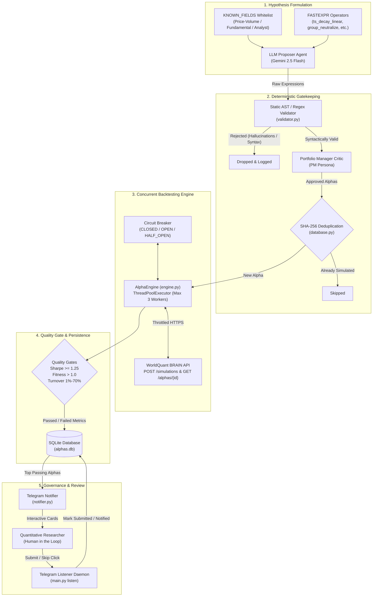
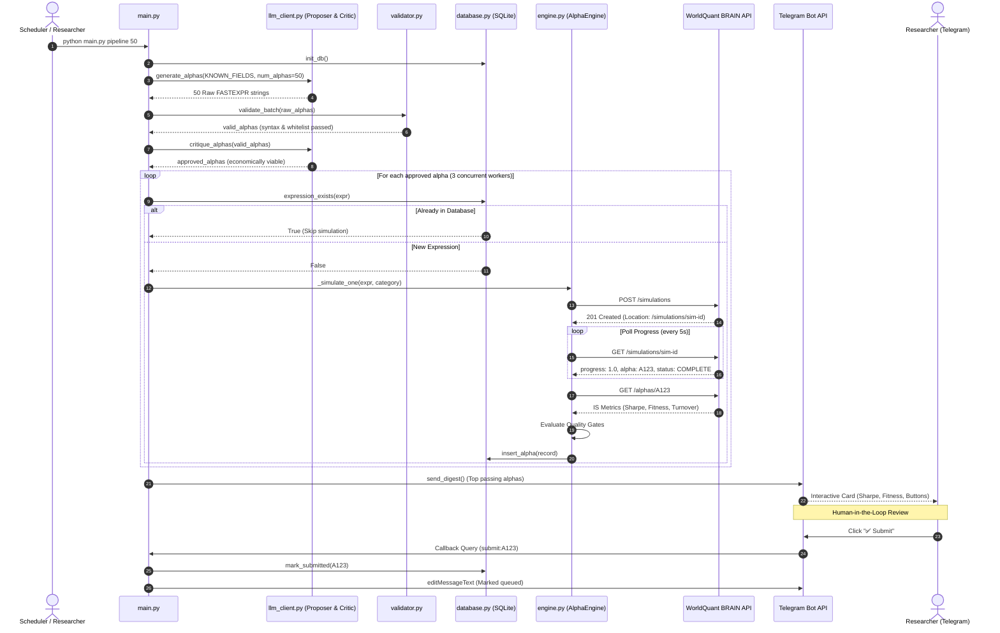

# System Architecture

The **WorldQuant BRAIN Autonomous Alpha Pipeline** is a multi-agent quantitative research system designed to discover, formulate, validate, backtest, and filter mathematical trading signals (alphas) for the WorldQuant BRAIN platform.

The system combines generative AI hypothesis formulation with deterministic static syntax gating, concurrent distributed backtesting, cryptographic deduplication, circuit-breaker fault tolerance, and human-in-the-loop review.

---

## 1. High-Level System Flow



---

## 2. Separation of Concerns

The pipeline enforces strict modularity where each component has an explicit, isolated boundary of responsibility:

```
worldquant-pipeline/
├── config.py         ──> Application Configuration & Dynamic Key Loader
├── api_client.py     ──> Thread-Safe BRAIN REST Transport & Token Management
├── llm_client.py     ──> Multi-Agent LLM Generation & PM Critic Filter
├── validator.py      ──> Deterministic AST / Regex Static Linter (Gatekeeper)
├── generator.py      ──> Field Quarantine Whitelist & Rule-Based Generator
├── engine.py         ──> 3-Worker Simulation Engine & Circuit Breaker Kill-Switch
├── database.py       ──> SQLite Persistence, Schema Migration & Deduplication
├── notifier.py       ──> Telegram Alerting & Interactive Callback Daemon
└── main.py           ──> CLI Entry Point & Pipeline Orchestration
```

### 2.1 Configuration Container (`config.py`)
- **Responsibility**: Single source of truth for runtime constants, threshold configuration, and environment variable loading.
- **Key Mechanics**:
  - Loads `.env` via `python-dotenv`.
  - Exposes typed module constants (`BRAIN_BASE_URL`, `MIN_SHARPE`, `TOKEN_TTL_SECONDS`).
  - Scans `os.environ` for `GEMINI_API_KEY_*` variables, sorting them by index suffix into `GEMINI_API_KEYS`.
  - Encapsulates settings inside a frozen dataclass `Settings` with case-insensitive attribute access (`settings.BRAIN_BASE_URL` or `settings.brain_base_url`).

### 2.2 API Client (`api_client.py`)
- **Responsibility**: Sole HTTP communication layer interacting with the WorldQuant BRAIN platform.
- **Key Mechanics**:
  - `BrainClient` wraps a persistent `requests.Session`.
  - **Thread-Safe Token Management**: Implements double-checked locking (`_ensure_token`) around a `threading.Lock`. Cached bearer token expires after 14,400s (4 hours) with a 300s proactive refresh margin.
  - **Single 401 Re-Authentication**: Automatically invalidates token and issues a single re-auth cycle if a 401 Unauthorized is returned.
  - **HTTP 429 Backoff**: Extracts `Retry-After` headers and sleeps accordingly (defaulting to 60s) before a single retry.
  - **Network Dropout Recovery**: Catches `requests.exceptions.RequestException`, waits 5 seconds, and retries once.
  - Raises custom `BrainApiError(status, body)`.

### 2.3 LLM Client (`llm_client.py`)
- **Responsibility**: Generative hypothesis formulation and critique using the official Google GenAI SDK.
- **Key Mechanics**:
  - Interacts with `gemini-2.5-flash` using `google-genai` SDK and JSON-schema output modes.
  - **Dynamic Key Rotation**: Maintains an internal index over `GEMINI_API_KEYS`. When an HTTP 429 (`RESOURCE_EXHAUSTED`) is caught, it automatically rotates to the next API key and retries once.
  - **Proposer Agent (`generate_alphas`)**: Prompted as an elite quantitative researcher tasked with formulating non-trivial, multi-factor FASTEXPR expressions using advanced operators.
  - **PM Critic Agent (`critique_alphas`)**: Prompted as a strict Quantitative Portfolio Manager to veto redundant, economically trivial, or unviable expressions. Implements a **fail-open** design to avoid dropping valid hypotheses if parsing fails.

### 2.4 Static Validator (`validator.py`)
- **Responsibility**: Hard gatekeeper preventing invalid, hallucinated, or unsafe expressions from reaching BRAIN network endpoints.
- **Key Mechanics**:
  - Checks for balanced parentheses.
  - Enforces strict character allowlist (`a-zA-Z0-9_() ,+-*/?<>=!`).
  - Blocks Python keyword injections (`import`, `eval`, `class`, `def`).
  - **Hallucination Detection**: Tokenizes identifiers after stripping numeric and scientific notation literals (`1e-9`). Compares every token against the union of `KNOWN_FIELDS` and `ALLOWED_OPERATORS`.
  - **Arity Enforcement**: Validates that multi-argument operators like `group_rank` contain at least two comma-separated parameters.

### 2.5 Field Repository & Rule-Based Generator (`generator.py`)
- **Responsibility**: Maintains verified data fields and provides a deterministic rule-based generator fallback.
- **Key Mechanics**:
  - **Field Quarantine Strategy**: Only fields verified in BRAIN documentation or data explorer are included in `KNOWN_FIELDS`. Unverified candidates remain segregated in `UNVERIFIED_FIELDS`.
  - `generate_expressions(n, seed, categories)`: Generates reproducible, diverse alpha expressions using template families (`rank`, `ts_rank`, `ts_delta`, `ts_zscore`, `ts_mean`, `group_rank`, `ratio_pair`) across standard lookback windows `[5, 10, 20, 60]`.

### 2.6 Simulation Engine (`engine.py`)
- **Responsibility**: Concurrent dispatch and monitoring of simulation jobs on BRAIN.
- **Key Mechanics**:
  - `AlphaEngine` manages a `ThreadPoolExecutor` capped strictly at 3 workers (`max_workers=3`) to comply with BRAIN terms of service.
  - **Simulation Lifecycle**:
    1. Check SHA-256 expression hash in database; skip if already simulated.
    2. Submit simulation payload (`POST /simulations`).
    3. Poll simulation endpoint (`GET /simulations/<id>`) every 5 seconds until progress reaches 1.0 or status is `COMPLETE`.
    4. Fetch in-sample metrics (`GET /alphas/<alpha_id>`).
    5. Evaluate hard quality gates (`sharpe`, `fitness`, `turnover`).
    6. Persist alpha record and metrics to SQLite.
  - **Circuit Breaker (`CircuitBreaker`)**: Three-state state machine (`CLOSED`, `OPEN`, `HALF_OPEN`). Trips after 3 consecutive HTTP 429 errors, immediately halting all workers and dispatching a Telegram alert. Implements a 300-second cooldown before testing recovery in `HALF_OPEN`.

### 2.7 Database Layer (`database.py`)
- **Responsibility**: Embedded persistence, expression deduplication, and pipeline state tracking.
- **Key Mechanics**:
  - SQLite backend using `sqlite3.Row` factory.
  - **Cryptographic Deduplication**: Calculates SHA-256 hash of whitespace-stripped, lowercased expressions (`hash_expression`) and enforces a `UNIQUE` index on `expression_hash`.
  - Tracks simulation metrics, timestamps, notification state (`notified = 0|1`), and human submission state (`submitted = 0|1`).
  - Auto-initializes schema and migrates legacy tables seamlessly.

### 2.8 Notifier & Interactive Listener (`notifier.py`)
- **Responsibility**: Real-time researcher alerting and human-in-the-loop decision capture.
- **Key Mechanics**:
  - `send_digest()`: Formats passing alphas into Telegram cards with in-sample metrics and inline buttons (`Submit` / `Skip`).
  - `poll_actions()`: Long-polling listener querying Telegram `getUpdates`.
    - Clicking **Submit** updates the database record to `submitted = 1` and edits the message card to reflect the queued status.
    - Clicking **Skip** updates `notified = 1` and marks the card skipped.
  - `send_alert()`: Transmits critical runtime alerts (e.g., Circuit Breaker trip) directly to chat.

### 2.9 Unified CLI Orchestrator (`main.py`)
- **Responsibility**: End-to-end command-line interface tying subsystems together.
- **Subcommands**:
  - `auth`: Verify credentials and print token expiry.
  - `generate <N>`: Generate $N$ rule-based expressions.
  - `simulate <N> [--mock]`: Simulate $N$ expressions.
  - `status`: Output summary statistics from SQLite.
  - `digest [--send]`: Preview or dispatch passing alphas.
  - `listen`: Run the Telegram interaction listener daemon.
  - `pipeline <N> [--mock]`: Execute the full multi-agent workflow:
    $$\text{Init DB} \longrightarrow \text{Propose (LLM)} \longrightarrow \text{Validate} \longrightarrow \text{Critique} \longrightarrow \text{Simulate (3 Workers)} \longrightarrow \text{Digest (Telegram)}$$

---

## 3. Data Flow & State Machine


